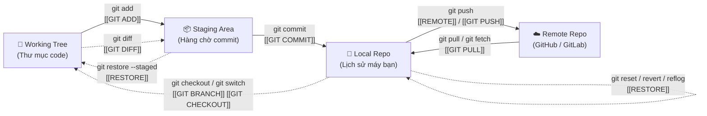

# ⚡ HỆ THỐNG TRA CỨU NHANH & BẢN ĐỒ LIÊN KẾT GIT

> 🧭 **Lộ trình học toàn diện:** [[lộ trình]]  
> 📊 **Tiến độ tài liệu:** 15/32 File đã hoàn thành (`[x]`) | 17 File kế hoạch (`[ ]`)  
> 💡 *Mẹo Obsidian:* Nhấp vào link `[[Tên file]]` để chuyển đến bài học. Đối với file chưa tạo, click vào link sẽ tự động tạo file ghi chú mới!

---

## 🗺️ 1. Bản đồ tổng quan: "File này làm cái gì?"

Bảng dưới đây tóm tắt mục đích cốt lõi, lệnh chính và thời điểm bạn nên mở từng file tài liệu trong kho kiến thức Git.

| File (Obsidian Link) | Trạng thái | Giai đoạn | "File này làm cái gì?" (Mục đích cốt lõi) | Lệnh chính cốt lõi | Khi nào cần mở file này? |
| :--- | :---: | :---: | :--- | :--- | :--- |
| **[[GIT INIT]]** | [x] | 1 | Khởi tạo repository Git mới (tạo folder `.git`) hoặc tải repo có sẵn về máy. | `git init`, `git clone`, `git init -b main` | Khi bắt đầu dự án mới hoặc clone source code từ GitHub. |
| **[[GIT STATUS]]** | [x] | 1 | Soi trạng thái cây làm việc: xem file nào mới (`untracked`), file nào đã sửa (`modified`), file nào sẵn sàng commit (`staged`). | `git status`, `git status -s`, `git status -b` | Trước và sau mọi thao tác `add`/`commit` để kiểm soát thay đổi. |
| **[[GIT ADD]]** | [x] | 1 | Đưa các thay đổi từ thư mục làm việc vào Staging Area (chọn lọc nội dung đóng gói vào commit). | `git add .`, `git add <file>`, `git add -p` | Khi code xong một phần và muốn chuẩn bị lưu vào lịch sử. |
| **[[GIT COMMIT]]** | [x] | 1 | Chụp snapshot các thay đổi trong Staging Area thành mốc lịch sử vĩnh viễn kèm lời nhắn. | `git commit -m`, `git commit --amend`, `git commit -am` | Khi hoàn thành một tính năng hoặc một mốc code ổn định. |
| **[[GIT LOG]]** | [x] | 1 | Xem lại lịch sử các commit đã tạo từ mới đến cũ, vẽ cây nhánh và lọc tác giả. | `git log --oneline`, `git log --graph --all`, `git log -p` | Khi muốn kiểm tra tiến trình dự án, lấy mã hash commit. |
| **[[GIT DIFF]]** | [x] | 1 | So sánh chi tiết từng dòng code: dòng nào thêm (`+`), dòng nào xóa (`-`) giữa working tree, staging và commit. | `git diff`, `git diff --staged`, `git diff HEAD` | Trước khi `git add` hoặc commit để rà soát tránh sửa nhầm code. |
| **[[GIT SHOW]]** | [ ] | 1 | Soi chi tiết toàn bộ nội dung thay đổi và metadata của một commit hoặc tag cụ thể. | `git show <hash>`, `git show --stat` | Khi có mã hash commit và muốn xem commit đó sửa những gì. |
| **[[GIT CONFIG]]** | [ ] | 2 | Cấu hình Git: tên người dùng, email, nhánh mặc định, alias và cài đặt repo. | `git config --global user.name`, `git config --list` | Khi mới cài Git hoặc muốn đổi thông tin tác giả commit. |
| **[[GIT FILE OPERATIONS]]** | [ ] | 2 | Thao tác file đồng bộ với Git: xóa file (`rm`), đổi tên/di chuyển (`mv`), xóa khỏi Git nhưng giữ trên ổ đĩa. | `git rm <file>`, `git rm --cached <file>`, `git mv` | Khi muốn bỏ theo dõi file hoặc đổi tên file an toàn. |
| **[[gitignore]]** | [x] | 2 | Khai báo các file/thư mục Git không được theo dõi (file nhạy cảm `.env`, rác build `node_modules/`, log). | Cú pháp: `*.log`, `dir/`, `!name`, `/build` | Ngay khi tạo dự án để tránh đẩy nhầm file rác hoặc secret lên Git. |
| **[[RESTORE]]** | [x] | 2, 4 | Bộ "cứu hộ" toàn diện: hủy thay đổi file chưa commit, bỏ staging, sửa commit, reset, revert và `reflog`. | `git restore <file>`, `git restore --staged`, `git commit --amend`, `git reset`, `git revert`, `git reflog` | **Bất cứ khi nào làm sai:** sửa nhầm, add nhầm, commit nhầm, mất dấu commit. |
| **[[GIT CLEAN]]** | [ ] | 2 | Dọn sạch các file rác chưa theo dõi (`untracked files`) khỏi thư mục làm việc. | `git clean -n` (xem trước), `git clean -fd` (xóa ép) | Sau khi test hoặc build lỗi muốn dọn sạch thư mục cấp tốc. |
| **[[REMOTE]]** | [x] | 3 | Quản lý kết nối giữa repo trên máy với máy chủ từ xa (GitHub/GitLab) và đẩy/kéo code. | `git remote -v`, `git remote add origin <url>`, `git push -u origin main` | Khi muốn đưa code lên GitHub để sao lưu và cộng tác. |
| **[[SETUP HTTPS + GITHUB CLI]]** | [x] | 3 | Hướng dẫn kết nối và đăng nhập GitHub bằng HTTPS, token PAT và công cụ GitHub CLI (`gh`). | `gh auth login`, `credential.helper store` | Khi bị lỗi xác thực, permission denied hoặc muốn đăng nhập nhanh. |
| **[[SSH KEY - ĐỌC THÊM]]** | [x] | 3 | Tạo và cài đặt SSH key (ed25519) để push code an toàn tuyệt đối mà không cần mật khẩu/token. | `ssh-keygen -t ed25519`, thêm public key vào GitHub | Khi muốn thiết lập phương thức xác thực an toàn, lâu dài trên máy cá nhân. |
| **[[GIT PUSH]]** | [ ] | 3 | Đẩy commit từ máy cá nhân lên nhánh tương ứng trên remote repository. | `git push`, `git push -u origin <branch>`, `git push --force-with-lease` | Khi đã commit xong ở local và muốn chia sẻ lên GitHub. |
| **[[GIT PULL]]** | [x] | 3 | Tải thay đổi mới từ remote về và tự động gộp vào nhánh hiện tại (`fetch` + `merge`). | `git pull`, `git pull origin main`, `git pull --no-rebase` | Đầu ngày làm việc hoặc trước khi push để cập nhật code mới nhất. |
| **[[GIT SYNC]]** | [ ] | 3 | Xử lý khi lịch sử local và remote bị lệch nhau (`divergent branches`, `non-fast-forward`). | `git fetch --prune`, `git branch -vv`, cấu hình `pull.rebase` | Khi bị GitHub từ chối push do người khác đã push trước. |
| **[[GIT BRANCH]]** | [x] | 4 | Quản lý các luồng phát triển song song: tạo, xem, xóa nhánh và gộp nhánh (`merge`), xử lý conflict. | `git branch`, `git switch -c <name>`, `git merge <name>`, `git branch -d` | Khi làm tính năng mới mà không muốn làm hỏng nhánh chính `main`. |
| **[[GIT CHECKOUT]]** | [x] | 4 | Hiểu lệnh đa năng cũ `checkout` và chuyển đổi sang các lệnh hiện đại (`switch`, `restore`). | `git checkout <branch>`, `git switch`, `git checkout --ours/--theirs` | Khi đọc tài liệu cũ hoặc cần chọn nhánh khi giải quyết conflict. |
| **[[GIT STASH]]** | [ ] | 4 | Cất tạm thay đổi đang làm dở vào "ngăn kéo bí mật" để dọn sạch working tree, sau đó lấy lại. | `git stash`, `git stash pop`, `git stash list` | Đang code dở thì có việc gấp cần chuyển sang nhánh khác. |
| **[[GIT CHERRY-PICK]]** | [ ] | 4 | "Nhặt" đúng một commit cụ thể từ một nhánh khác đưa vào nhánh hiện tại. | `git cherry-pick <commit-hash>` | Khi cần đem một bản hotfix từ nhánh dev vào main mà không gộp cả nhánh. |
| **[[REBASE]]** | [x] | 4 | Viết lại lịch sử commit: dời gốc nhánh để giữ lịch sử thẳng đẹp, gộp/sắp xếp commit (`rebase -i`). | `git rebase <target>`, `git rebase -i HEAD~3`, `git rebase --continue` | Muốn gộp dọn dẹp các commit vụn vặt trước khi tạo Pull Request. |
| **[[GITHUB PULL REQUEST]]** | [ ] | 5 | Quy trình tạo Pull Request (PR), review code, trao đổi phản hồi và merge trên GitHub. | Push branch -> Open PR -> Code Review -> Merge | Khi làm việc nhóm và muốn đưa mã nguồn của mình vào nhánh chính. |
| **[[GITHUB FORK UPSTREAM]]** | [ ] | 5 | Nhân bản repo người khác về tài khoản cá nhân (Fork), kết nối `upstream` và đồng bộ thay đổi. | `git remote add upstream <url>`, `git fetch upstream` | Khi đóng góp cho dự án Open Source hoặc repo của tổ chức khác. |
| **[[GIT TEAM WORKFLOW]]** | [ ] | 5 | Quy trình chuẩn hóa làm việc nhóm: đặt tên branch, commit message, giải quyết conflict nhóm. | Git Flow, GitHub Flow, Conventional Commits | Khi thiết lập văn hóa làm việc và quy chuẩn code cho team. |
| **[[GIT TAGS RELEASES]]** | [ ] | 6 | Đánh dấu mốc phiên bản (v1.0.0, v2.0.0) và phát hành GitHub Release kèm ghi chú thay đổi. | `git tag -a v1.0.0 -m "Release"`, `git push origin --tags` | Khi phát hành sản phẩm hoặc đóng gói một bản release ổn định. |
| **[[GIT BLAME GREP]]** | [ ] | 6 | Soi tác giả từng dòng code (`blame`) và tìm kiếm chuỗi/hàm trong toàn bộ kho code (`grep`). | `git blame <file>`, `git grep -n "keyword"` | Khi cần điều tra xem đoạn code này ai viết, viết vào commit nào. |
| **[[GIT BISECT]]** | [ ] | 6 | Dùng thuật toán nhị phân tự động truy tìm chính xác commit nào trong lịch sử gây ra lỗi bug. | `git bisect start`, `git bisect bad`, `git bisect good` | Khi app bị bug mà không biết phát sinh từ commit nào trong hàng trăm commit. |
| **[[GIT INTERNALS]]** | [ ] | 7 | Đi sâu vào bản chất: cấu trúc dữ liệu bên trong Git (blob, tree, commit, tag, thư mục `.git`). | `git cat-file -p <hash>`, `git ls-files` | Khi muốn hiểu sâu tận gốc rễ cơ chế lưu trữ của Git. |
| **[[GIT WORKTREE]]** | [ ] | 7 | Làm việc đồng thời trên nhiều nhánh ở nhiều thư mục riêng biệt mà không cần clone lại repo. | `git worktree add <path> <branch>`, `git worktree list` | Khi muốn mở song song 2 nhánh để đối chiếu hoặc build mà không cần chuyển nhánh. |
| **[[GIT SUBMODULE]]** | [ ] | 7 | Nhúng một repository Git khác vào bên trong repo hiện tại dưới dạng thư mục con. | `git submodule add <url>`, `git submodule update --init` | Khi dự án phụ thuộc vào mã nguồn của một repo dùng chung khác. |
| **[[GIT HOOKS SERVER]]** | [ ] | 7 | Cài đặt kịch bản tự động chạy trước khi commit/push (`pre-commit`) và dựng máy chủ Bare Git. | `.git/hooks/`, `git init --bare` | Khi muốn kiểm tra định dạng code tự động hoặc dựng Git server nội bộ. |

---

## 🚑 2. Bảng cứu nguy: "Tôi đang gặp vấn đề gì?"

Tìm tình huống bạn đang gặp phải bên dưới để nhảy thẳng vào file giải quyết:

```
VẤN ĐỀ CỦA BẠN                         FILE CỨU NGUY                   LỆNH NHANH
───────────────────────────────────────────────────────────────────────────────────
Lỡ sửa bậy trong file, muốn quay lại      [[RESTORE]]                     git restore <file>
Lỡ `git add` nhầm file rác / nhạy cảm     [[RESTORE]]                     git restore --staged <file>
Vừa commit xong phát hiện sai lời nhắn    [[RESTORE]] / [[GIT COMMIT]]    git commit --amend
Lỡ commit nhầm mà ĐÃ PUSH lên GitHub      [[RESTORE]]                     git revert <hash>
Lỡ `reset --hard` làm mất sạch commit     [[RESTORE]]                     git reflog
Đang code dở, sếp bắt đổi nhánh gấp      [[GIT STASH]]                   git stash (rồi git stash pop)
Bị conflict khi merge hoặc rebase         [[GIT BRANCH]] / [[REBASE]]     Sửa marker >>>>>, rồi git add
Bị lỗi lệch nhánh khi pull về             [[GIT PULL]]                    git config --global pull.rebase false
Không muốn Git theo dõi file bí mật/.env  [[gitignore]]                   Thêm tên file vào .gitignore
Bị hỏi password liên tục khi push         [[SETUP HTTPS + GITHUB CLI]]    gh auth login hoặc lưu token
Đổi sang dùng SSH key cho an toàn         [[SSH KEY - ĐỌC THÊM]]          ssh-keygen -t ed25519
Muốn bốc 1 commit sửa bug sang nhánh khác [[GIT CHERRY-PICK]]             git cherry-pick <hash>
Muốn biết ai là thủ phạm viết dòng này    [[GIT BLAME GREP]]              git blame <file>
Tìm commit gây bug trong hàng trăm commit [[GIT BISECT]]                  git bisect start
```

---

## 🔄 3. Sơ đồ chu trình dữ liệu Git & Liên kết bài học



---

## 📂 4. Phân loại theo nhóm chức năng

### Nhóm 1: Cơ bản & Chu trình làm việc cục bộ (Stage 1)
- **Bắt đầu:** [[GIT INIT]]
- **Quan sát & So sánh:** [[GIT STATUS]] ➔ [[GIT DIFF]]
- **Đóng gói & Lưu trữ:** [[GIT ADD]] ➔ [[GIT COMMIT]]
- **Tra cứu lịch sử:** [[GIT LOG]] ➔ [[GIT SHOW]]

### Nhóm 2: Quản lý File, Bỏ qua & Cấu hình (Stage 2)
- **Cấu hình máy:** [[GIT CONFIG]]
- **Loại trừ file rác:** [[gitignore]]
- **Thao tác file:** [[GIT FILE OPERATIONS]] ➔ [[GIT CLEAN]]
- **Cứu hộ file:** [[RESTORE]]

### Nhóm 3: Remote, Đồng bộ & Xác thực GitHub (Stage 3)
- **Kết nối máy chủ:** [[REMOTE]]
- **Xác thực:** [[SETUP HTTPS + GITHUB CLI]] ➔ [[SSH KEY - ĐỌC THÊM]]
- **Đẩy & Tải dữ liệu:** [[GIT PUSH]] ➔ [[GIT PULL]] ➔ [[GIT SYNC]]

### Nhóm 4: Nhánh, Xung đột & Tối ưu hóa lịch sử (Stage 4)
- **Quản lý nhánh:** [[GIT BRANCH]] ➔ [[GIT CHECKOUT]]
- **Tạm cất thay đổi:** [[GIT STASH]]
- **Gộp nhánh:** [[GIT BRANCH]] (Merge) ➔ [[REBASE]]
- **Nhặt commit:** [[GIT CHERRY-PICK]]
- **Hoàn tác sâu:** [[RESTORE]] (`reset`, `revert`, `reflog`)

### Nhóm 5: Làm việc nhóm & Đóng góp cộng đồng (Stage 5)
- **Đóng góp tính năng:** [[GITHUB PULL REQUEST]]
- **Mã nguồn mở:** [[GITHUB FORK UPSTREAM]]
- **Quy chuẩn đồng đội:** [[GIT TEAM WORKFLOW]]

### Nhóm 6: Phát hành, Tìm kiếm & Điều tra lỗi (Stage 6)
- **Đóng gói phiên bản:** [[GIT TAGS RELEASES]]
- **Truy tìm code:** [[GIT BLAME GREP]]
- **Dò tìm nguồn gốc bug:** [[GIT BISECT]]

### Nhóm 7: Chuyên sâu & Tự động hóa (Stage 7)
- **Bản chất dưới đáy:** [[GIT INTERNALS]]
- **Đa không gian làm việc:** [[GIT WORKTREE]]
- **Kho phụ thuộc:** [[GIT SUBMODULE]]
- **Kịch bản tự động:** [[GIT HOOKS SERVER]]

---

## 🎯 5. Kế hoạch hoàn thiện các file còn thiếu

Dưới đây là danh sách 17 file dự kiến tạo tiếp theo, sắp xếp theo thứ tự ưu tiên học tập:

- [ ] **Ưu tiên cao (Thường dùng hàng ngày):**
  - [ ] [[GIT SHOW]]: Xem chi tiết commit
  - [ ] [[GIT CONFIG]]: Cấu hình danh tính và alias
  - [ ] [[GIT STASH]]: Cất tạm code dở dang
  - [ ] [[GIT CHERRY-PICK]]: Bốc commit đơn lẻ
  - [ ] [[GITHUB PULL REQUEST]]: Quy trình tạo và duyệt PR
  - [ ] [[GIT FILE OPERATIONS]]: Xóa và đổi tên file đồng bộ
  - [ ] [[GIT CLEAN]]: Dọn dẹp file rác untracked

- [ ] **Ưu tiên trung bình (Phối hợp nhóm & Quản lý):**
  - [ ] [[GIT PUSH]]: Đầy đủ tùy chọn đẩy code nâng cao
  - [ ] [[GIT SYNC]]: Xử lý lệch nhánh nâng cao
  - [ ] [[GITHUB FORK UPSTREAM]]: Đóng góp mã nguồn mở
  - [ ] [[GIT TEAM WORKFLOW]]: Quy chuẩn đặt tên, commit, merge
  - [ ] [[GIT TAGS RELEASES]]: Quản lý phiên bản phần mềm
  - [ ] [[GIT BLAME GREP]]: Truy tìm tác giả và đoạn code

- [ ]    **Ưu tiên nâng cao (Chuyên gia & Dự án lớn):**
  - [ ] [[GIT BISECT]]: Dò bug tự động
  - [ ] [[GIT INTERNALS]]: Cấu trúc nội tại `.git`
  - [ ] [[GIT WORKTREE]]: Nhiều thư mục làm việc song song
  - [ ] [[GIT SUBMODULE]]: Quản lý repo con
  - [ ] [[GIT HOOKS SERVER]]: Tự động hóa linting và server bare

---
> 🔗 **Quay lại:** Xem chi tiết từng bước học tại [[lộ trình]].
